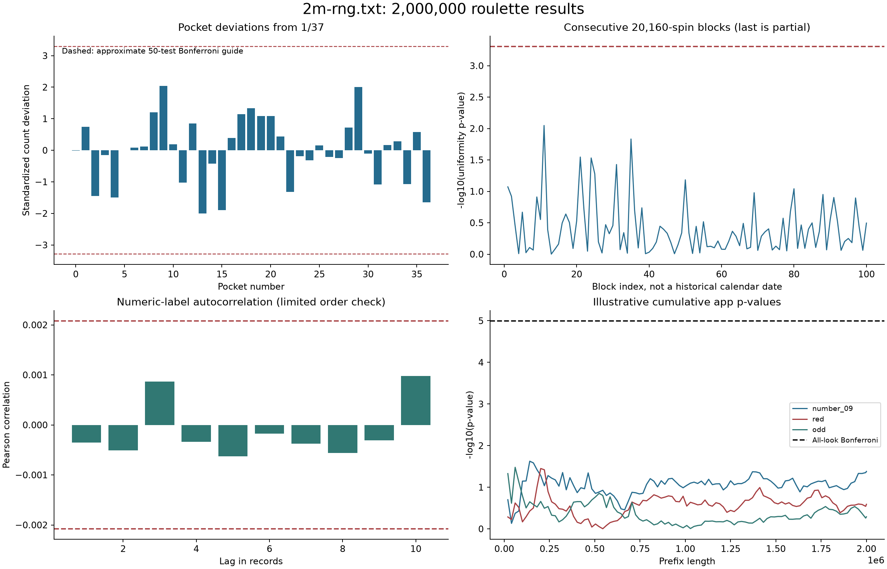

# Analysis of 2m-rng.txt using the bias calculator

Analysis date: 2026-10-16 (Asia/Kuala_Lumpur).

## Usage and expected output

Run from the repository's `rou` folder with Python 3.12+ and Node.js:

```powershell
python -m pip install -r docs/2m_rng_analysis/requirements-analysis.txt
python docs/2m_rng_analysis/analyze_2m_rng.py
```

The app defaults to `../bias_calc/index.html`; pass `--app PATH` if needed.
Run in an analysis environment rather than modifying application dependencies.
The script validates the input, writes CSV/JSON/PNG artifacts, checks the
attached app's math against SciPy, and regenerates this report. Expected
summary: 2,000,000 valid rows; 5,066 frequentist checks;
0 experiment-wide rejections. See
[`summary.json`](2m_rng_analysis/summary.json) for exact values and versions.

## Result and implication

**No statistically significant departure was detected by the fixed audit after
its experiment-wide correction.** No marginal uniformity null was rejected after
the 50-test Holm correction. No selected order diagnostic rejected after its
15-test Holm correction.

This supports compatibility with independent uniform roulette draws on the
tested properties. It does **not** prove true randomness, independence at
all lags, cryptographic unpredictability, physical-wheel provenance, or lack
of every possible bias. A publicly downloadable sequence is predictable
to anyone who knows its position, even if its frequencies look random.
Passing this audit therefore does not make replay an unpredictable live RNG.

Next step: retain the unchanged source and its checksum, investigate any
unadjusted alerts in their multiple-testing context, and request generator/
provenance information if stronger claims are needed. No input results were
filtered, shuffled, regenerated, or changed. No game code was modified.

## Data integrity and audit protocol

| Item | Observed value / evidence |
| --- | --- |
| Input | `rou/assets/2m-rng.txt` |
| Bytes | 7,459,206 |
| Valid integer rows | 2,000,000 |
| Invalid / blank rows discarded | 0; validation would abort instead |
| Supported values seen | All 37 integers, 0 through 36 |
| Input SHA-256 | `9de937459ef7970c8f08d913bf30c6c28320303ffc3de02c3c5725dd0af835d8` |
| Equation source | `bias_calc/index.html` |
| Equation-source SHA-256 | `2338c4c3900007dfca6ca5027067994f9ec968fe73637ca5cc31e941c22112f2` |
| Fair pocket probability | Exact 1/37 = 2.702702703% |
| Expected count per pocket | 54054.054054 |
| Complete replay weeks | 99 of 20,160 spins |
| Remaining partial week | 4,160 spins |

Evidence: strict parser and checksums in the reproducible script and
[`protocol.json`](2m_rng_analysis/protocol.json). Blank/invalid rows are not
silently skipped. The analysis is retrospective: the initial counts were
inspected before the fixed test script was written. This is not a preregistered
prospective experiment. Mappings and thresholds were then held fixed across
the full dataset; selected illustrative plots do not change the test family.

Null model: independent, identically distributed categorical draws with
probability 1/37 for each pocket. The primary marginal question is uniformity;
order diagnostics additionally examine limited forms of non-independence.

## How the app's equations were applied

The app accepts W/L observations, so it cannot ingest a roulette integer
without a mapping. For each number, W means that number occurred; otherwise
L. For outside bets, W means membership of the named set. Zero loses all
even-money outside bets and is not treated as odd/even or red/black.

There are 49 fixed mappings: 37 pockets; red/black; odd/even; low/high;
three dozens; and three columns. Their exact null probabilities are 1/37,
18/37, or 12/37. The app's default 0.5 and rounded 0.027 are not substituted
for the correct roulette values.

### 1. One-time binomial review

For count k in N observations, the supplied app defines:

```text
X ~ Binomial(N, p0)
p_app = min(1, 2 * min(P(X <= k), P(X >= k)))
```

Source: `twoSidedP`, app lines 385-389, with inclusive tails from lines
371-383. This doubled-tail definition is deliberately retained. It can
differ from another library's probability-ordered two-sided binomial test.
Raw app threshold: 0.05. Holm adjustment covers the 49 mappings plus the
37-pocket omnibus test: 50 marginal tests. Arbitrarily dependent mappings
do not invalidate Holm's familywise adjustment.

For sorted p-values p(1) <= ... <= p(m), the adjusted value at rank i is
min(1, max over j<=i of (m-j+1)*p(j)). The saved code applies that rule
without assuming the categories or prefixes are independent.

### 2. Sequential monitor, with an explicit finite checking schedule

The app reuses the same p-value and flags p < 0.001 (lines 520-553).
Its 'overall 0.05' field is reference-only; it does not control repeated
looks. Dividing alpha by a fixed 20 or 50 does not provide a general
guarantee for indefinitely checking every record.

This audit evaluates 100 cumulative prefixes: each
completed 20,160-spin block and the final incomplete block. Across 49
mappings, that is 4,900 opportunities. To bound their
combined false-alarm probability at 0.05 under the null, the Bonferroni
per-opportunity threshold is 1.020408163e-05.

Observed: 0 app-threshold alerts, versus
0 schedule-corrected alerts. These are
retrospective scheduled-prefix diagnostics, **not** a replay of every
possible stopping time. Use a valid alpha-spending/confidence-sequence
method before deploying continuous real-time inference.

### 3. Beta-binomial posterior estimates

Preserving the app's Beta(1,1) prior and its equations (lines 556-580):

```text
p | data ~ Beta(k+1, N-k+1)
posterior mean = (k+1)/(N+2)
95% interval = Beta quantiles at 0.025 and 0.975
P(p > p0) = Beta survival probability at p0
P(p < p0) = Beta CDF at p0
app stop = max(P(p > p0), P(p < p0)) > 0.99
```

At the final sample, 0 of 49 mappings meet that
directional stop rule. These are marginal posterior direction probabilities,
not probabilities that 'the whole generator is biased'. A continuous Beta
prior assigns zero probability to exact equality p=p0 before seeing data,
so P(p != p0) is not a useful fairness probability under this model. A
posterior threshold also does not automatically control the frequentist
false-alarm rate across many categories or repeated stopping.

For an explicitly illustrative practical tolerance, the CSV also gives
posterior probability outside p0 +/- 1% of p0. That tolerance was not
provided by the owner and is not an accepted product bias threshold.
Separate marginal Beta(1,1) priors are app-compatible binary analyses, not
a single coherent 37-category Dirichlet posterior.

### 4. Power and the app's required-N display

`criticalRegion`, `exactPower`, and `requiredN` are at app lines 392-438.
Power sums binomial probabilities in both rejection tails under a specified
alternative p1. The required-N search uses fixed normal-score constants as
an initial bracket, discrete-power binary search, and a 100-million guard
only while expanding that bracket. It is not a general proof of the exact
minimum N; discrete rejection regions can make power nonmonotone locally.

Do not estimate 'more records needed' from the same observed deviation and
use it as additional evidence for bias. Here, sensitivity is calculated for
declared hypothetical relative effects of +/-1% and +/-5%, using exact
binomial tails at the actual N. No data-dependent required-N claim is used
to decide fairness. The attached app's sample-size and power outputs for
the three most deviant pockets are also cross-checked and retained in
[`app_math_validation.json`](2m_rng_analysis/app_math_validation.json).

| Observed-effect example | App required N | SciPy power there |
| --- | --- | --- |
| number_09 | 3,790,704 | 80.000017% |
| number_29 | 3,907,088 | 80.001847% |
| number_13 | 3,925,210 | 80.042952% |

These observed-effect examples reproduce the app's display. They are not
prospective sample-size recommendations or additional evidence for bias.

## Marginal results

Overall Pearson goodness-of-fit statistic:
chi-square = **36.926257000**, df = 36,
raw p = **0.425931599**,
50-test Holm p = **1**.

3 of the individual mappings cross unadjusted
0.05; 0 cross the marginal-family adjusted
threshold. The largest absolute pocket frequency deviation is
0.865700% **relative** to 1/37;
relative percent is not the same as percentage points.

The smallest raw pocket p-value is for number_09, with
54,522 occurrences, 2.726100%
frequency, p=0.04173682, and corrected
p=1. This pocket is highlighted because it is the
observed extreme, not because it was selected before seeing the data.

| Category | Count | Observed % | Deviation, pp | App p | Holm p |
| --- | --- | --- | --- | --- | --- |
| number_00 | 54,053 | 2.702650 | -0.000053 | 0.998621 | 1 |
| number_01 | 54,226 | 2.711300 | +0.008597 | 0.454525 | 1 |
| number_02 | 53,722 | 2.686100 | -0.016603 | 0.148039 | 1 |
| number_03 | 54,020 | 2.701000 | -0.001703 | 0.884206 | 1 |
| number_04 | 53,710 | 2.685500 | -0.017203 | 0.133894 | 1 |
| number_05 | 54,054 | 2.702700 | -0.000003 | 1 | 1 |
| number_06 | 54,074 | 2.703700 | +0.000997 | 0.931883 | 1 |
| number_07 | 54,081 | 2.704050 | +0.001347 | 0.907656 | 1 |
| number_08 | 54,330 | 2.716500 | +0.013797 | 0.229838 | 1 |
| number_09 | 54,522 | 2.726100 | +0.023397 | 0.0417368 | 1 |
| number_10 | 54,098 | 2.704900 | +0.002197 | 0.849224 | 1 |
| number_11 | 53,820 | 2.691000 | -0.011703 | 0.30847 | 1 |
| number_12 | 54,250 | 2.712500 | +0.009797 | 0.393976 | 1 |
| number_13 | 53,596 | 2.679800 | -0.022903 | 0.0458014 | 1 |
| number_14 | 53,956 | 2.697800 | -0.004903 | 0.670968 | 1 |
| number_15 | 53,618 | 2.680900 | -0.021803 | 0.0572981 | 1 |
| number_16 | 54,144 | 2.707200 | +0.004497 | 0.696085 | 1 |
| number_17 | 54,317 | 2.715850 | +0.013147 | 0.252548 | 1 |
| number_18 | 54,359 | 2.717950 | +0.015247 | 0.184505 | 1 |
| number_19 | 54,303 | 2.715150 | +0.012447 | 0.278707 | 1 |
| number_20 | 54,302 | 2.715100 | +0.012397 | 0.280644 | 1 |
| number_21 | 54,154 | 2.707700 | +0.004997 | 0.66415 | 1 |
| number_22 | 53,751 | 2.687550 | -0.015153 | 0.186903 | 1 |
| number_23 | 54,011 | 2.700550 | -0.002153 | 0.853313 | 1 |
| number_24 | 53,981 | 2.699050 | -0.003653 | 0.75219 | 1 |
| number_25 | 54,089 | 2.704450 | +0.001747 | 0.880076 | 1 |
| number_26 | 54,007 | 2.700350 | -0.002353 | 0.839651 | 1 |
| number_27 | 53,998 | 2.699900 | -0.002803 | 0.809093 | 1 |
| number_28 | 54,219 | 2.710950 | +0.008247 | 0.473128 | 1 |
| number_29 | 54,515 | 2.725750 | +0.023047 | 0.0448887 | 1 |
| number_30 | 54,031 | 2.701550 | -0.001153 | 0.922198 | 1 |
| number_31 | 53,807 | 2.690350 | -0.012353 | 0.282283 | 1 |
| number_32 | 54,091 | 2.704550 | +0.001847 | 0.873202 | 1 |
| number_33 | 54,119 | 2.705950 | +0.003247 | 0.778213 | 1 |
| number_34 | 53,809 | 2.690450 | -0.012253 | 0.286211 | 1 |
| number_35 | 54,186 | 2.709300 | +0.006597 | 0.566218 | 1 |
| number_36 | 53,677 | 2.683850 | -0.018853 | 0.100356 | 1 |
| red | 973,775 | 48.688750 | +0.040101 | 0.256819 | 1 |
| black | 972,172 | 48.608600 | -0.040049 | 0.257443 | 1 |
| odd | 973,436 | 48.671800 | +0.023151 | 0.512883 | 1 |
| even | 972,511 | 48.625550 | -0.023099 | 0.513849 | 1 |
| low_1_18 | 972,897 | 48.644850 | -0.003799 | 0.914973 | 1 |
| high_19_36 | 973,050 | 48.652500 | +0.003851 | 0.91378 | 1 |
| dozen_1 | 648,907 | 32.445350 | +0.012918 | 0.696859 | 1 |
| dozen_2 | 648,492 | 32.424600 | -0.007832 | 0.813602 | 1 |
| dozen_3 | 648,548 | 32.427400 | -0.005032 | 0.879826 | 1 |
| column_1 | 647,833 | 32.391650 | -0.040782 | 0.218195 | 1 |
| column_2 | 649,311 | 32.465550 | +0.033118 | 0.317437 | 1 |
| column_3 | 648,803 | 32.440150 | +0.007718 | 0.816166 | 1 |

Exact machine-readable values and app flags are in
[`category_results.csv`](2m_rng_analysis/category_results.csv). Its
Clopper-Pearson intervals use alpha/49 per category, providing simultaneous
at-least-95% coverage for these 49 binary probabilities under the model.
The app's ordinary 95% posterior intervals are marginal, not simultaneous.

Five most deviant pockets, with the app's posterior calculations:

| Pocket | Posterior mean % | 95% credible interval % | P(p > p0) | App 0.99 stop |
| --- | --- | --- | --- | --- |
| number_09 | 2.726147 | [2.703623, 2.748761] | 0.979343 | False |
| number_29 | 2.725797 | [2.703275, 2.748409] | 0.977781 | False |
| number_13 | 2.679847 | [2.657511, 2.702274] | 0.022894 | False |
| number_15 | 2.680947 | [2.658606, 2.703378] | 0.028641 | False |
| number_36 | 2.683897 | [2.661544, 2.706340] | 0.050166 | False |

## Sequence order and independence diagnostics

These checks supplement the app, whose W/L count summaries cannot detect
all order effects. A repeating 0,1,...,36 cycle could have perfect pocket
counts and still be completely deterministic.

- Pearson numeric-label correlations at lags 1 through 10 use a large-sample
  normal approximation. Numeric labels are only one projection of the data.
- Binary runs tests use red/non-red, odd/non-odd, and low/non-low, retaining
  zero in the complementary category. Conditional run-count mean/variance
  follow the standard two-class runs test; no continuity correction.
- A 37-by-37 independence table uses **non-overlapping** pairs (rows 1/2,
  3/4, ...), avoiding a naive independent-cell claim for overlapping pairs.
  It has 1,000,000 pairs, df=1296, and minimum
  fitted expected cell count 711.634.
- A separate app-form binomial test checks equality within those disjoint
  pairs against probability 1/37 under independent uniform draws.

Holm correction covers all 15 order diagnostics.

| Check | Statistic | Raw p | Holm p (15) |
| --- | --- | --- | --- |
| numeric_lag_1 | -0.0003516693 | 0.618953 | 1 |
| numeric_lag_2 | -0.0005105666 | 0.470264 | 1 |
| numeric_lag_3 | 0.0008678651 | 0.219693 | 1 |
| numeric_lag_4 | -0.0003415395 | 0.629089 | 1 |
| numeric_lag_5 | -0.0006263674 | 0.375717 | 1 |
| numeric_lag_6 | -0.0001744653 | 0.805117 | 1 |
| numeric_lag_7 | -0.0003739979 | 0.596867 | 1 |
| numeric_lag_8 | -0.0005646426 | 0.424567 | 1 |
| numeric_lag_9 | -0.0003058823 | 0.665319 | 1 |
| numeric_lag_10 | 0.0009804377 | 0.165581 | 1 |
| runs_red | 998990 | 0.647342 | 1 |
| runs_odd | 999102 | 0.784364 | 1 |
| runs_low | 999945 | 0.336878 | 1 |
| disjoint_pair_independence | 1269.491 | 0.695379 | 1 |
| disjoint_pair_equal | 27031 | 0.982138 | 1 |

These checks can miss longer-period, nonlinear, state-dependent, or
cryptographic structure. Counts and order tests do not identify how the
source file was generated.

## Consecutive blocks and replay-week relevance

There are 99 complete 20,160-spin blocks plus a final
4,160-spin block. These are sequential input sections,
not dated physical-wheel observations. Each is tested against uniformity;
the shorter last block uses its own expected counts.

Raw 0.05 block flags: 5; corrected flags:
0. The correction family also includes
a contingency-table homogeneity test across blocks:
chi-square=3488.732, df=3564,
raw p=0.8132547. See
[`weekly_blocks.csv`](2m_rng_analysis/weekly_blocks.csv).

Do not discard, reorder, or choose only weeks that pass tests; doing so
would alter the source and its statistical interpretation. The required
weekly extraction can preserve contiguous original rows without changing
these analysis results.

## Prospective sensitivity at the actual sample size

Relative effects mean multiplicative changes in p0, not percentage-point
shifts. For a pocket, +1% means p1=(1/37)*1.01. The .05/49 scenarios use a
conservative Bonferroni threshold for the 49 binary mappings. Actual Holm
power depends on the joint pattern of alternatives and is not claimed here.

| Mapping | Relative effect | Alpha | Power at 2M |
| --- | --- | --- | --- |
| single_number | -1% | 0.05 | 65.516% |
| single_number | -1% | 0.00102041 | 17.647% |
| single_number | +1% | 0.05 | 65.188% |
| single_number | +1% | 0.00102041 | 17.550% |
| single_number | -5% | 0.05 | 100.000% |
| single_number | -5% | 0.00102041 | 100.000% |
| single_number | +5% | 0.05 | 100.000% |
| single_number | +5% | 0.00102041 | 100.000% |
| red | -1% | 0.05 | 100.000% |
| red | -1% | 0.00102041 | 100.000% |
| red | +1% | 0.05 | 100.000% |
| red | +1% | 0.00102041 | 100.000% |
| red | -5% | 0.05 | 100.000% |
| red | -5% | 0.00102041 | 100.000% |
| red | +5% | 0.05 | 100.000% |
| red | +5% | 0.00102041 | 100.000% |

Power below 80% for a specified small effect means the audit may miss it;
it does not make the observed file biased. High power does not prove the
generator is unpredictable or free of untested structure.

## Numerical validation and software

- Source-app math runs in an isolated Node VM containing only the math
  declarations, with a timeout. No DOM handlers or app instructions execute.
- 54 cases compare app doubled-tail p-values,
  posterior direction probabilities, and credible limits with SciPy.
- Maximum absolute p-value discrepancy:
  1.95476e-08; posterior-direction
  discrepancy: 1.08356e-08;
  credible-limit discrepancy: 7.52898e-13.
- Validation tolerances: absolute p/posterior-direction error below 1e-6;
  credible-limit error below 1e-7; current-N power error below 1e-6.
- Five small-N p-values are independently checked by summing binomial PMFs
  with integer binomial coefficients, rather than trusting one implementation.
- App power/required-N cases are retained with achieved power recomputed by
  SciPy; their limitations are stated above.
- Software: Python 3.12.14, NumPy 2.5.4,
  SciPy 1.18.1, Matplotlib 3.11.2.

Across all four frequentist families there are 5,066
p-values. An additional audit-wide Holm correction produces
0 rejections. Family-specific adjusted values
remain available, so a broader correction does not hide their results.
Bayesian stop flags are not p-values and are not part of that correction.



## Files and sources

- [`analyze_2m_rng.py`](2m_rng_analysis/analyze_2m_rng.py): reproducible audit.
- [`verify_app_math.cjs`](2m_rng_analysis/verify_app_math.cjs): original-math
  extraction and numerical comparisons.
- [`protocol.json`](2m_rng_analysis/protocol.json): fixed mappings, settings,
  checksums, look schedule, and retrospective-design disclosure.
- [`summary.json`](2m_rng_analysis/summary.json): exact summary and versions.
- [`frequentist_tests.csv`](2m_rng_analysis/frequentist_tests.csv): all raw,
  family-adjusted, and experiment-wide adjusted p-values.
- [`monitoring_prefixes.csv`](2m_rng_analysis/monitoring_prefixes.csv): complete
  finite-prefix app-monitor audit, including schedule adjustment.
- [`order_tests.csv`](2m_rng_analysis/order_tests.csv) and
  [`power_sensitivity.csv`](2m_rng_analysis/power_sensitivity.csv): diagnostics.
- Equation source: `C:/automation/prototypes/bias_calc/index.html`, especially
  lines 321-453 and 486-580. Only its numerical methods were used; explanatory
  claims are evaluated rather than treated as instructions or guarantees.
- [SciPy binomial reference](https://docs.scipy.org/doc/scipy/reference/generated/scipy.stats.binom.html):
  binomial tails and numerical implementation.
- [SciPy Beta reference](https://docs.scipy.org/doc/scipy/reference/generated/scipy.stats.beta.html):
  posterior distribution CDF/survival/quantiles.
- [NIST goodness-of-fit reference](https://www.itl.nist.gov/div898/handbook/eda/section3/eda35f.htm):
  categorical goodness-of-fit interpretation.
- [NIST runs-test reference](https://www.itl.nist.gov/div898/handbook/eda/section3/eda35d.htm):
  conditional run-count diagnostics.
- [NIST Bonferroni inequality](https://www.itl.nist.gov/div898/handbook/prc/section4/prc473.htm):
  finite-family simultaneous error/coverage control via the union bound.
- [NIST randomness-testing limits](https://nvlpubs.nist.gov/nistpubs/Legacy/SP/nistspecialpublication800-22.pdf):
  statistical tests cannot substitute for analysis of generator construction.

All numerical claims in this report come from the unchanged checksummed
input and saved audit outputs. No legal classification or source-provenance
claim is made. Input file and app hashes should be rechecked before comparing
this report with later versions.
