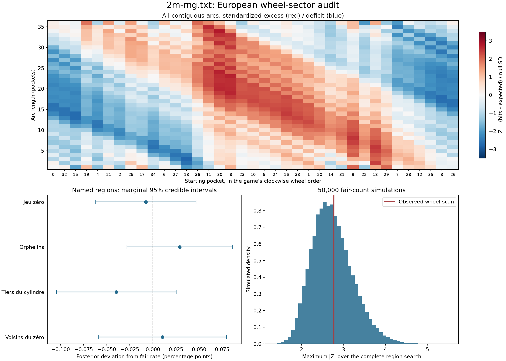

# Roulette wheel-sector analysis of 2m-rng.txt

Analysis date: 16 October 2026 (Asia/Kuala_Lumpur).

## Usage and expected output

From `C:/automation/prototypes/rou`, using the original analysis dependencies:

```powershell
python -m pip install -r docs/2m_rng_analysis/requirements-analysis.txt
python docs/2m_rng_analysis/analyze_wheel_sectors.py
```

Expected output: this report; sector CSV/JSON files; a compressed complete
prefix-monitor CSV; simulation maxima; an app-math cross-check; and a chart
under `docs/2m_rng_sector_analysis`. Input, frontend, and calculator source
files are read without modification. The script imports the existing audit's
documented binomial, Holm, power, and serialization helpers.

## Finding and next-step implication

**No region rejected after correction for the 1,337-test sector family.** The
strongest wheel-order concentration is not unusual relative to the fair-wheel
scan simulations.

This is a retrospective frequency test in physical wheel **order**, using
the same 2,000,000 results. It addresses whether hits concentrate in a
named sector or contiguous arc, rather than only at individual pockets.
It does not prove that the source came from a physical wheel or that a
particular rotor/ball mechanism is unbiased. A public replay is still
predictable if its position is known.

The source should remain unchanged. These findings do not justify discarding
weeks, rearranging numbers, or inventing a new extraction offset. Very small
effects and untested time-varying or physical-angle effects can remain.

## Definitions and the complete search

Wheel order was parsed from `const ORDER` in `rou/index.html` near line 155:

```text
0 32 15 19 4 21 2 25 17 34 6 27 13 36 11 30 8 23 10 5 24 16 33 1 20 14 31 9 22 18 29 7 28 12 35 3 26
```

The four called-bet region memberships were parsed from `const CALLS` near
line 225. This uses unique covered pockets, not chip allocation weights:

- **Voisins du zéro**: 0 2 3 4 7 12 15 18 19 21 22 25 26 28 29 32 35.
- **Tiers du cylindre**: 5 8 10 11 13 16 23 24 27 30 33 36.
- **Orphelins**: 1 6 9 14 17 20 31 34.
- **Jeu zéro**: 0 3 12 15 26 32 35.

Voisins, Tiers, and Orphelins partition all 37 pockets (17 + 12 + 8).
Orphelins covers two disjoint arcs; Jeu zero is a seven-pocket arc within
Voisins. This matches the named-set coverage in the operator's published
rules [S3]. Called-bet profit is not determined by hit frequency alone,
because the wager legs and unit allocations can have different returns.
This audit tests landing probability, not called-bet profitability.

To avoid selecting just a visually attractive arc, every clockwise start
position and every nontrivial size from 1 to 36 is included: 37 * 36 =
1,332 arcs. Arcs wrap across zero. Add the four named regions for 1,336
binary tests. Sizes 1 and 36 also revisit the previous single-pocket tests
or their complements; these are not independent new evidence.

Complementary arcs give the same two-sided binomial p-value, and some named
sets duplicate scanned arcs. They are retained transparently. Holm remains
valid with dependent/duplicate hypotheses and can be conservative. An
additional scan simulation accounts directly for the correlated search.
There is no unique 18.5-pocket half-wheel; sizes 18 and 19 are both covered.

## Same calculator equations, correct sector probabilities

For a region of m unique pockets, W means a result lands in that region,
L means it lands outside, and p0=m/37. Thus X~Binomial(N,m/37) under the
independent uniform null. The calculator's doubled-inclusive-tail formula is:

```text
p_app = min(1, 2 * min(P(X <= observed), P(X >= observed)))
posterior = Beta(observed+1, N-observed+1)
posterior P(favoured) = P(p > m/37 | observed data)
app Bayesian stop = max(P(p > p0), P(p < p0)) > 0.99
```

The same Beta(1,1) prior, marginal 95% credible intervals, 0.05 one-time
threshold, and 0.001 app-monitor threshold are retained. An ordinary 0.5
baseline would be wrong for these sectors. Membership is defined in wheel
order, not numerical runs such as 1-12.

## Named sector results

| Region | Pockets | Fair % | Observed % | Excess pp | App p | Holm p (4) |
| --- | --- | --- | --- | --- | --- | --- |
| Voisins du zéro | 17 | 45.945946 | 45.956400 | +0.010454 | 0.767253 | 1 |
| Tiers du cylindre | 12 | 32.432432 | 32.392950 | -0.039482 | 0.233237 | 0.932949 |
| Orphelins | 8 | 21.621622 | 21.650650 | +0.029028 | 0.319069 | 0.957207 |
| Jeu zéro | 7 | 18.918919 | 18.911250 | -0.007669 | 0.782674 | 1 |

No claim about arbitrary arcs is inferred only from the four named tests.
The three-way sector-partition omnibus gives chi-square
1.788318864, df=2, p=0.408951206.
Its Holm p in the complete 1,337-test sector family is
1.

| Region | 95% credible probability interval | P(p > fair) | App stop |
| --- | --- | --- | --- |
| Voisins du zéro | [0.45887340, 0.46025476] | 0.616666 | False |
| Tiers du cylindre | [0.32328128, 0.32457841] | 0.116523 | False |
| Orphelins | [0.21593625, 0.21707785] | 0.840792 | False |
| Jeu zéro | [0.18857039, 0.18965582] | 0.391206 | False |

Posterior intervals/probabilities are **marginal** app outputs, not
simultaneous guarantees or probabilities that the whole generator is biased.
The continuous prior has no point mass at exact fairness. A high probability
on one side of p0 can concern a tiny deviation; significance and practical
effect size remain separate questions.

## Arbitrary contiguous sectors

Most favoured standardized arc (selected after scanning the full file):

- Pockets, clockwise: **30 8 23 10 5 24 16 33 1 20 14 31 9 22 18 29 7 28 12 35 3 26 0 32 15 19 4 21 2 25 17 34 6 27**.
- Size: 34 pockets; hits: 1,838,907.
- Fair share: 91.891892%; observed share:
  91.945350%.
- Excess: +0.053458 percentage points, or
  +0.058175% relative to its fair share.
- Z=2.769684; raw two-sided p=0.00559176066;
  complete-family Holm p=1.

This is the most favoured **standardized** arc, not necessarily the arc with
the greatest raw number of extra hits. Larger sectors naturally have more
hits, so their fair expectations and variance must be included.

The broad 34-pocket surplus is the complement of a
3-pocket deficit at **13 36 11**. For a more
compact view, among arcs of at most 18 pockets the strongest positive region
is **9 22 18 29 7 28 12 35** (8 pockets):
21.694150% observed versus
21.621622% fair, raw p=0.01277752,
complete-family Holm p=1. This compact region
is also selected after searching; its raw p is not a standalone discovery.

| Size | Clockwise pockets | Count | Z | Raw p | Holm p (1337) |
| --- | --- | --- | --- | --- | --- |
| 34 | 30 8 23 10 5 24 16 33 1 20 14 31 9 22 18 29 7 28 12 35 3 26 0 32 15 19 4 21 2 25 17 34 6 27 | 1,838,907 | 2.7697 | 0.00559176 | 1 |
| 24 | 30 8 23 10 5 24 16 33 1 20 14 31 9 22 18 29 7 28 12 35 3 26 0 32 | 1,299,113 | 2.6894 | 0.00716428 | 1 |
| 23 | 8 23 10 5 24 16 33 1 20 14 31 9 22 18 29 7 28 12 35 3 26 0 32 | 1,245,082 | 2.6809 | 0.00735007 | 1 |
| 19 | 8 23 10 5 24 16 33 1 20 14 31 9 22 18 29 7 28 12 35 | 1,028,911 | 2.6653 | 0.00770694 | 1 |
| 20 | 30 8 23 10 5 24 16 33 1 20 14 31 9 22 18 29 7 28 12 35 | 1,082,942 | 2.6404 | 0.00829461 | 1 |
| 20 | 8 23 10 5 24 16 33 1 20 14 31 9 22 18 29 7 28 12 35 3 | 1,082,931 | 2.6248 | 0.0086846 | 1 |
| 35 | 11 30 8 23 10 5 24 16 33 1 20 14 31 9 22 18 29 7 28 12 35 3 26 0 32 15 19 4 21 2 25 17 34 6 27 | 1,892,727 | 2.6114 | 0.00898591 | 1 |
| 21 | 30 8 23 10 5 24 16 33 1 20 14 31 9 22 18 29 7 28 12 35 3 | 1,136,962 | 2.6075 | 0.00913478 | 1 |
| 22 | 8 23 10 5 24 16 33 1 20 14 31 9 22 18 29 7 28 12 35 3 26 0 | 1,190,991 | 2.5950 | 0.00947148 | 1 |
| 23 | 30 8 23 10 5 24 16 33 1 20 14 31 9 22 18 29 7 28 12 35 3 26 0 | 1,245,022 | 2.5934 | 0.00951304 | 1 |

There are 236 raw p<0.05 flags among all 1,336 regions,
but 0 after Holm correction for the 1,336 binary
tests plus the partition test. Unadjusted flags from searching overlapping
arcs are not independent discoveries. The two-sided scan also tests deficits;
a deficit for one arc can appear as a surplus in its complementary arc.

The app's unadjusted 0.99 posterior-direction stop rule triggers for
64 of the 1,336 regions. Those flags concern many
overlapping/complementary sets and are not independent discoveries or a
0.99 posterior probability that the generator is biased. They do not
provide a search-wide false-alarm guarantee. The calibrated whole-search
result below addresses how unusual the selected strongest effect is under
the specified fair null.

## A calibrated test of the strongest apparent sector

Statistic: T=max over all 1,336 regions of absolute standardized deviation.
Under the fair null, simulate complete count vectors from
Multinomial(N, [1/37,...,1/37]) and perform **the same entire search** on each.
This includes all start positions, lengths, and named regions; it does not
compare a selected arc against an unsearched single-arc reference.

- Observed T: 2.7696840.
- Fair simulations: 50,000; fixed seed 20261016.
- Simulations with T >= observed: 21,775.
- Selection-adjusted Monte Carlo p: **0.4355113**,
  calculated as (exceedances+1)/(simulations+1).
- Estimated Monte Carlo standard error: 0.002217.
- 95% interval for the underlying simulation tail probability:
  [0.431148,
  0.439860]. This interval measures simulation
  precision, not the probability the wheel is fair.
- Fair-scan 95th percentile of T: 3.614612.
- A further Holm correction across six headline tests (four named tests,
  their partition test, and this global scan) gives scan
  p=1.0000000.

This calibration is conditional on the stated IID uniform null. It is not
a correction for every analysis ever performed on this source. The earlier
audit and this requested follow-up are not represented as a preregistered
single prospective experiment.

## Sequential and weekly checks

The app's monitor was evaluated at 100 cumulative
prefixes: each full 20,160-spin week and the final partial section. Across
1,336 regions there are 133,600 checks. Bonferroni for an
overall 0.05 schedule goal uses p < 3.74251497e-07.

- Raw app p<0.001 prefix alerts: 30.
- All-look corrected prefix alerts: 0.
- Raw named-sector 0.05 flags across 100 individual blocks and four names:
  17.
- Corrected named-block flags across those 400 tests:
  0.

These are finite-prefix and named-block checks, not an assertion that every
arbitrary arc was tested at every possible stopping time or every weekly
block. Full cumulative-prefix results are saved as compressed CSV to keep
the complete table manageable. The earlier audit supplies additional whole-
sequence/order diagnostics. Small recurring checks do not automatically
inherit a 5% false-alarm guarantee from the app's reference-only field.

## Sensitivity and limitations

Power for hypothetical +/-1% **relative** shifts in named sector probability
at this N, using the app's exact binomial rejection tails and conservative
alpha=0.05/1337:

| Region | Relative shift | Corrected alpha | Power |
| --- | --- | --- | --- |
| voisins | -1% | 3.7397158e-05 | 100.000% |
| voisins | +1% | 3.7397158e-05 | 100.000% |
| tiers | -1% | 3.7397158e-05 | 100.000% |
| tiers | +1% | 3.7397158e-05 | 100.000% |
| orphelins | -1% | 3.7397158e-05 | 99.955% |
| orphelins | +1% | 3.7397158e-05 | 99.950% |
| zero | -1% | 3.7397158e-05 | 99.673% |
| zero | +1% | 3.7397158e-05 | 99.648% |

Those are planning scenarios, not observed-effect sample-size claims.
Reported powers may round to 100%; that is not a proof that every possible
bias is detectable. Small arcs have lower power for the same relative shift.
Combining data from different real wheels or alternating source processes
could also conceal opposing biases. The file supplies outcomes, without
wheel identity, rotor orientation, ball launch angle, speed, or timestamps.
Physical-angle bias and generator unpredictability need additional evidence.

## Numerical checks and artifacts

All 1336 region p-values, posterior direction
probabilities, and credible intervals were checked directly against the
attached calculator's isolated math declarations. Maximum absolute errors:
p=6.916286e-07; posterior direction
=3.390688e-07; interval endpoint
=1.040945e-12. Validation passed using the
same tolerances as the original audit. No UI/event-handler code executes.

Source SHA-256: `9de937459ef7970c8f08d913bf30c6c28320303ffc3de02c3c5725dd0af835d8`.
Geometry, calculator hashes, exact membership sets, simulation seed, and
check schedule are recorded in the protocol.



- [Reproducible sector script](2m_rng_analysis/analyze_wheel_sectors.py).
- [Protocol](2m_rng_sector_analysis/protocol.json).
- [Summary](2m_rng_sector_analysis/summary.json).
- [All named-sector and arc results](2m_rng_sector_analysis/sector_results.csv).
- [Complete finite-prefix monitor CSV, gzip](2m_rng_sector_analysis/sector_prefix_monitor.csv.gz).
- [Named sectors by weekly block](2m_rng_sector_analysis/named_weekly_sectors.csv).
- [Monte Carlo calibration](2m_rng_sector_analysis/scan_calibration.json).
- [Saved fair-scan maxima](2m_rng_sector_analysis/null_scan_maxima.npy).
- [App numerical validation](2m_rng_sector_analysis/app_math_validation.json).
- [Sensitivity scenarios](2m_rng_sector_analysis/named_sector_power.csv).
- [Original pocket/order analysis](2M_RNG_ANALYSIS.md).

## Sources

- [S1] `rou/index.html`: exact wheel order and called-bet memberships,
  extracted from the current source and checksummed in the protocol.
- [S2] `bias_calc/index.html`: doubled binomial tails, Beta posterior,
  monitoring defaults, and exact-power equations. The supplementary script
  uses the existing audit helpers and cross-checks the original math.
- [S3] [Loto-Quebec published roulette rules](https://assets.lotoquebec.com/ressources/assets/v3/assets/blt8296e79a7001648c/blt064c43f7eba0d096/6470f7c980a2483496a7cc4b/instant-roulette-regles-fr.pdf),
  pages 3-4: named-region memberships and the two-arc Orphelins definition.
- [SciPy binomial reference](https://docs.scipy.org/doc/scipy/reference/generated/scipy.stats.binom.html)
  and [Beta reference](https://docs.scipy.org/doc/scipy/reference/generated/scipy.stats.beta.html):
  stable numerical tails and posterior quantiles.
- [NIST Bonferroni inequality](https://www.itl.nist.gov/div898/handbook/prc/section4/prc473.htm):
  finite-family error control even when the regions overlap.

All result claims are derived from the saved unchanged data and audit
outputs. This supplement does not modify game behavior, infer source
provenance, or authorize changes to the weekly extraction.
