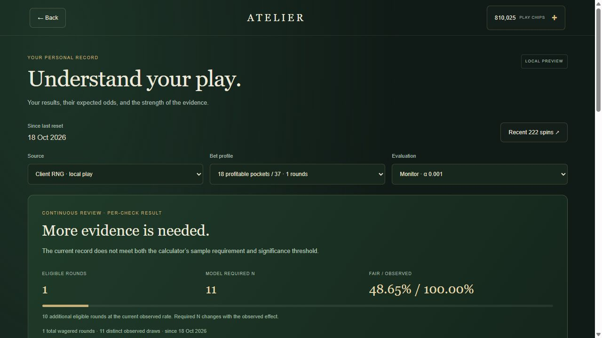
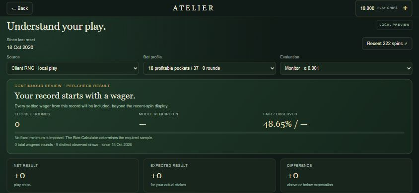

# Implementation 01: Collection and Insights preview

Updated: 18 October 2026 | Asia/Kuala_Lumpur

## Run and review

With Python 3 on your PATH, serve the repository's parent directory:

```powershell
cd C:\automation\prototypes
python -m http.server 8766 --bind 127.0.0.1
```

Open [the local game](http://127.0.0.1:8766/rou/). Use Guest play, then
**Shop**, **+ Chips**, or **Insights**. Serve over HTTP; the new JavaScript
modules require this. Keep the sibling `lib` directory available for the
existing Three.js loader. Stop the preview with Ctrl+C.

To run the automated checks:

```powershell
cd C:\automation\prototypes\rou
npm ci --ignore-scripts --no-audit --no-fund
npm test
```

Expected result on the tested Node 24.21.0 environment: **80 tests pass**.
Tests use loopback HTTP/WebSocket connections. The parity test reads the
sibling `bias_calc/index.html`, which must be present in the repository.
The browser preview was served with Codex's bundled Python runtime.

## What is implemented

This is the first local product slice authorized by the owner, built around
the existing table. It does not yet connect that table to shared multiplayer
accounts or a payment provider.

| Surface | Working behavior | Evidence |
| --- | --- | --- |
| Launch / Menu | Shop and Insights entry points; source controls on the launch screen; return without leaving the active session. | `index.html`, browser check. |
| Collection | Nine realistic images, approved chip prices, purchase confirmation, ownership, collection filter and one showcased item. | `client/catalogue.js`, browser check. |
| Chip shop | Five approved packs; local Guest simulator with success, declined and pending outcomes. | Collection tests and browser check. |
| Insights access | Non-renewing 30-day test pass; expiry and extension; detailed results unlocked after simulated success. | Collection tests and browser check. |
| Personal history | Settled rounds stored in IndexedDB under player and reset IDs; current record is not capped at 222. | Record store, 500-round test and browser reload. |
| Personal evidence | Calculator required N, raw p-value and both signal directions; identical free and paid verdict. | Calculator parity and independent reference tests. |
| Financial analysis | Full portfolio EV, net result, difference, descriptive risk score, drawdown and bet mix. | Portfolio tests and one observed browser settlement. |
| Wheel patterns | 37 pockets, 12 outside groups and four sectors; Holm correction across 53 tests at each look. | Analysis tests. |
| Reset | Confirmation after outstanding bets settle; new analysis epoch retains wallet, collection and access. | Browser guard and successful reset checks. |
| Export | Current raw-record JSON and an unlocked Markdown analysis report. | Implemented in `client/club.js`; download flow not browser-tested. |

The luxury golf course is **160,000,000 chips**, as the owner confirmed.
The 50,000-chip starter cosmetic remains a proposal and is not in the shop.
The 7-million-chip sale pack has no active promotion and is not offered.
The Insights USD 4.90 price is a **test hypothesis**, not an approved live
price. Tests collect no card data and charge no money.

## Mathematical contract

The numerical kernel in [bias-math.js](../client/bias-math.js) is copied
from the supplied [Bias Calculator](../../bias_calc/index.html). The parity
test checks source identity and numerical results. UI rules live separately
in [insights-model.js](../client/insights-model.js).

1. Compute net returns across all 37 outcomes for each settled portfolio.
2. Count outcomes yielding a net profit. A profile with `m` profitable
   pockets has fair probability `p0=m/37`.
3. Group rounds by that probability and source. One draw gives at most one
   player observation. Repeated replay rows do not add statistical samples.
4. Use the complete current record in the selected profile. The 23 October
   2026 update fixes the planning gap at five percentage points: pass each
   feasible `p1=p0-0.05` and `p1=p0+0.05` to `requiredN`. Use a shared target
   with exact power meeting the goal in both feasible directions.
5. Default to alpha 0.001 and power 0.80. A single-evaluation alpha of 0.05
   is available in details, as in the calculator.
6. Require `abs(wins/N-p0) >= 0.05`, `N >= planned N` and `p < alpha` for a
   signal. Report its direction relative to `p0`. Preserve the calculator
   kernel; the sample-size plan no longer uses the observed effect.

At 30 wins in 100 trials, default monitoring now plans 1,739 observations
for `p0=.5`, or 1,740 for `p0=18/37`. Both remain insufficient. A smaller
observed gap cannot raise an alert, regardless of sample size. The 80%
power goal applies to the statistical check at a real five-point gap,
before the extra observed-gap filter. Sources and current equations:
`client/insights-model.js`, `test/insights.test.js` and
[Rooms and Insights](ROOMS_AND_INSIGHTS.md).

These are per-check signals about the observed record. Repeated looks,
profile selection and repeated resets are not given lifetime error control.
The Beta interval assumes a stable event probability and Beta(1,1) prior.
A win-rate deviation does not establish positive future EV or permanent
personal luck. Financial totals include all settled wagers in the source,
including replay attempts; inference excludes duplicate draws. Purchases,
free replenishment and collectible spending are not roulette profit.

## Verification performed

On 18 October 2026:

- All 80 Node tests passed, including 11 new analysis/catalogue tests and
  the existing server integration suite. The Windows npm quoting and test
  fixture file-URL handling were corrected so the suite actually runs.
- Local Guest browser checks rejected a watch purchase with only 10,000
  chips. Declined and pending test payments left that balance unchanged.
- Completing a pending one-million-chip order produced 1,010,000 chips.
  Acquiring the watch left 810,000 and showed its thumbnail in the header.
- A real local 25-chip Red wager settled as a win during the check.
  Insights showed +25 net, -0.68 expected and +25.68 difference. Its one
  eligible observation had calculator required N = 11 and no signal.
- Reload retained the 810,025 wallet, watch, Insights expiry and raw
  current-record analysis. Menu preserved the active session.
- Reset was blocked while that wager was outstanding. After settlement it
  cleared current analysis, retained chips and access, and left the existing
  recent-spin Statistics screen usable.
- Shop and Insights were inspected at desktop and 390-by-844 CSS pixels.
  This is narrow-viewport testing, not a physical touch/rotation test.




Additional captures: [narrow collection](implementation_01/collection-narrow.jpg)
and [narrow Insights](implementation_01/insights-narrow.jpg).

### Compact mobile landscape correction

Shop, Insights and their confirmations now share the game's 1120-pixel
logical landscape surface. They scale to the phone and rotate with the
existing portrait-held fallback. The compact header keeps Back accessible
while scrolling. Collection cards use three columns, chip packs use five,
and Insights controls, sample figures and result totals use three. Longer
reports and the remaining collectibles remain scrollable.

Browser layout checks used 844-by-390 and 390-by-844 viewports, with phone
detection enabled only in the temporary local test response. Both full-page
dialogs filled the viewport without horizontal overflow. Rotation while
Insights and checkout were open preserved their landscape layout. The chip
purchase buttons fit in the landscape screen, and item and Insights
confirmations remained centered. These are emulated layout checks; physical
touch-device testing remains outstanding. The earlier narrow captures above
predate this correction.




[Portrait-held rotation check](implementation_01/insights-mobile-portrait-held.jpg)

## Storage and current limits

Collection ownership, showcased item, test orders, pass expiry and reset ID
are saved with the existing bankroll JSON. Guest storage remains local;
Google Drive metadata uses the existing save/conflict flow. Raw analysis
stays in this device's IndexedDB and is not synchronized through Drive.
Google sign-in and Drive persistence were not exercised in these checks.

History capture starts with this implementation. Legacy 222-number history
does not contain wager portfolios and is not fabricated into old personal
results. Passive observations are recorded while the local session runs;
offline missed empty rounds are not reconstructed. A saved pending wager
can settle on resume using the existing recovery path. An unavailable
replay file leaves that recovery observation in a separate unidentified
source instead of mixing it with a known feed. Device storage can fail or
be cleared, and closing during an asynchronous write can leave a gap.
This coverage must not be sold as complete server-held account history.

Reset switches to a new epoch; old local records remain stored. There is no
archive browser yet. Automatic inactivity reset, account erasure and
historical-board treatment remain backend work. Reset does not erase the
account, bankroll, items or access. The table's session win/loss counter and
recent 222-spin source view retain their original session/window meanings.

The simulator is restricted to local Guest play and refuses Google test
credits. This is a convenience guard, not a security boundary. Local wallet,
ownership and access are client-editable and unsuitable for real billing or
official rankings. Guest multi-tab conflicts and a durable settlement/outbox
transaction are not solved by this slice. The worker currently reads the
whole current record; large account histories need server-side summaries.

## Artwork and next step

Nine 1536-by-1024 PNG images were generated with the built-in image_gen tool
and visually inspected. The shuttle was edited to remove incidental
lettering. Original generated files were retained; application copies are
in [assets/collectibles](../assets/collectibles/). The reproducible subject
prompts and shared art direction are in [manifest.json][assets]. Images load
lazily in the collection; their original PNG delivery is about 23 MB for
all nine and should be optimized before a public mobile launch.

The next phase is durable accounts, server-owned wallet and settlement,
six-player rooms and reconnect recovery. Then connect both products to an
approved provider sandbox with idempotent orders and server entitlements.
Live billing, production deployment, full Hall of Fame, daily wealth
compilation and weekly replay generation are not implemented here. Follow
the updated [product review][review] for the phased plan and remaining
owner decisions. No commit, push or deployment was performed in this step.

[assets]: ../assets/collectibles/manifest.json
[review]: MULTIPLAYER_PRODUCT_DESIGN_REVIEW.md
