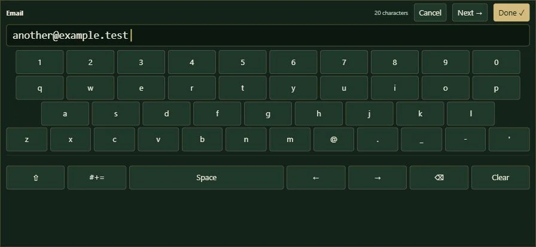

# Public login, shared-room repair and landscape keyboard

Updated: 20 October 2026 | Asia/Kuala_Lumpur

## Use this release

1. Open the [GitHub game][game] and select **Sign in**.
2. Enter the email for the intended account, or choose **New user**.
   No invitation code is required.
3. New players choose a username and a password of 12–128 characters.
   Enter the labelled on-screen test code to finish registration.
4. Login returns to launch. The player button shows the server username;
   opening it shows the account email, wealth and collection.
5. Choose **Multiplayer** to enter the shared six-seat room.
6. On a phone, tap an entry field to open the landscape keyboard.
   **Next** saves the field and moves forward; **Done** saves and closes;
   **Cancel** discards that field's pending edit. Desktop users can also
   select **On-screen keyboard**.

Expected result: all pages remain on GitHub while account and multiplayer
requests use Sites. Existing wallets and account names are preserved.
Signing into another email selects that email's account; the app does not
rename or merge accounts based on a locally remembered guest name. [E1]

## Changes and reasons

| Change | Result |
| --- | --- |
| Public registration | Email/password access replaces the invitation page. |
| Duplicate email | Explains that the email already has an account. |
| Duplicate username | Asks for a different username. |
| Account identity | Launch, table and profile use the server username. |
| Six-seat allocation | Uses a query accepted by the Sites database. |
| Landscape keyboard | Supports mixed case, spaces, digits and symbols. |
| Versioned frontend modules | Loads the matching account/UI modules together. |

The live room previously failed with
`D1_ERROR: too many terms in compound SELECT: SQLITE_ERROR`.
Seat allocation combined six `SELECT` terms using `UNION ALL`.
The replacement selects from a six-row `VALUES` table. The query still
allocates the lowest free seat atomically and preserves the six-seat
limit. Live join and settlement checks passed after publication. [E2, E4]

The keyboard extends the button-pad approach in
`attk/mjs/numeric-controls.mjs`. It uses a text display rather than a
focused editable textbox inside the overlay. It includes Shift, symbols,
Space, cursor arrows, Backspace, Clear, and password Show/Hide. Unicode
names can also be entered through hardware typing or paste. Usernames
accept letters, marks, numbers, spaces, periods, underscores, apostrophes
and hyphens, with at least one letter or number. [E3]



## Test-mode account recovery

New-account codes are intentionally displayed on screen. They do not
verify ownership of an email mailbox. This is still a test release.

Signed-out password recovery is disabled until an email sender is
connected. Displaying an existing account's recovery code publicly would
let someone who knows its email take over that account. The recovery
screen explains the limitation. Existing accounts can still log in with
their passwords; an operator can assist through developer controls. [E1]

Operator controls still require a configured operator account plus the
separate key. Public players cannot access user/RNG maintenance or
Start/Stop. The obsolete invitation controls are removed from the
developer page. Legacy backend invitation data is retained for
compatibility, without gating normal login or registration. [E1]

## Verification

From `rou/`:

```powershell
node --test --test-force-exit test/*.test.js
```

Expected: **84 tests pass**. This includes the existing roulette tests and
new keyboard editing tests for printable password characters, Unicode
cursor movement, deletion and length limits. [E3, E4]

From `rou/sites-server/`:

```powershell
node --test test/*.test.mjs
node node_modules/typescript/bin/tsc --noEmit
node scripts/run-framework.mjs build
```

Expected: **16 tests pass**, type checking succeeds and the production
build completes. Backend coverage includes public registration, duplicate
fields, origin restrictions, session authorization, recovery protection,
six seats, shared draws and settlement retries. [E4]

Additional checks completed:

- The actual seat query works with SQLite's compound-select limit set
  to five; it allocates six seats and refuses a seventh player.
- Two disposable live accounts register/verify, see each other, place
  wagers in the same round and receive the same result.
- Duplicate live wager submission debits once; repeated settlement
  preserves the same balance. Both players leave successfully.
- The mobile preview at 896 × 414 supports login entirely through the
  custom keyboard, including mixed case, spaces, digits and punctuation.
- Login returns to launch and the table displays the correct username.
- Duplicate-email and duplicate-username messages appear separately,
  with entered fields preserved after each error.
- Both letter and symbol keyboard layouts fit the landscape viewport.

Physical-phone native keyboard behavior and sustained concurrent load
remain unverified. The frontend stays on GitHub; Sites version 6 contains
the room fix, from source commit
`adfe7cef5db9cfef49c0863b275aae8e029bbaaa`. [E4]

## Evidence

- E1: `../client/account-api.js`, `account.js`, `game-account.js`,
  `admin.js`; backend `lib/service.mjs`, `frontend-access.mjs`,
  `security.mjs`, and `test/service.test.mjs`.
- E2: sanitized live Worker error from `room-join`, followed by
  `../sites-server/lib/room.mjs` and the published version 6 checks.
- E3: `../client/mobile-entry.js`, `entry-model.js`, `account.css`,
  `../test/entry-model.test.js`; referenced attk button-pad source.
- E4: test/build outputs, local mobile browser checks and live disposable
  account checks performed on 20 October 2026.

[game]: https://zhonecloud-sketch.github.io/prototypes/rou/
